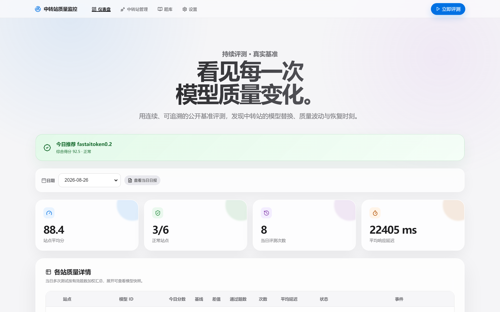
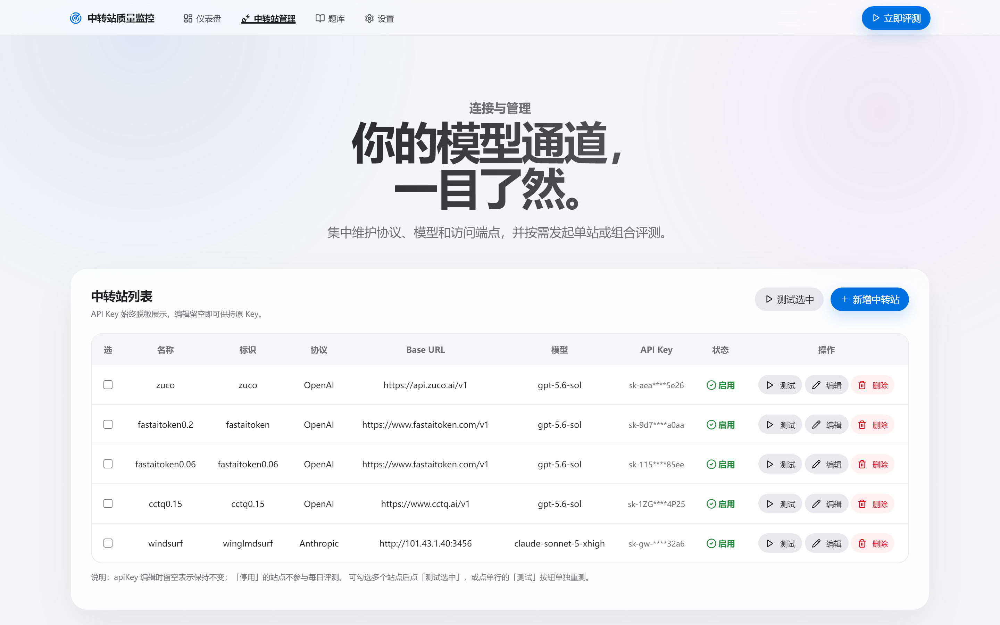
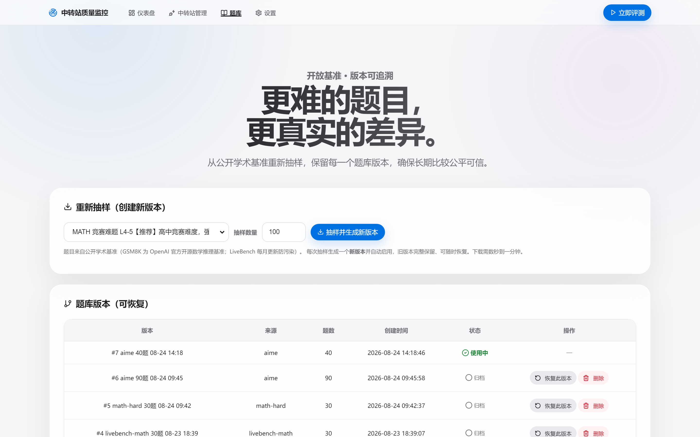

# Relay Monitor — API 中转站「掺水」监控系统

[](LICENSE)
[](https://www.python.org/)
[](https://nodejs.org/)

> 你花钱买的 GPT / Claude 中转站 API，有没有被偷偷换成降智模型？
> 这个系统每天用**开源标准竞赛题库**自动实测打分，用连续的历史基线告诉你：哪家在掺水、哪家恢复了、哪家现在最值得用。



## 为什么需要这个项目

单次跑分只能看到「当前分数」，无法发现**偷偷降智**。判断掺水需要三件事：

1. **固定题库** — 每天同一批题，答案稳定可比
2. **固定参数** — 温度 0、固定 max_tokens，OpenAI 推理等级默认 `xhigh`，保持评测条件一致
3. **连续历史基线** — 当日分数 vs 近 7 天滑动基线，跌破了才叫掺水

Relay Monitor 把这三件事打包成一个可以长期挂着跑的 Web 系统：
每天定时自动评测多个中转站，自动标记「疑似掺水 / 已恢复 / 稳定 / 评测异常」，
并推荐当前质量最好的站点。

## 核心特性

- **多难度开源标准题库**（题目全部来自公开数据集，不是自编题）：
  - **AIME 美国数学邀请赛**【极高难】90 题，GPT-4o 正确率仅 ~13%，顶级推理模型 50-85%，区分度极高
  - **MATH 竞赛难题 L4-5**【推荐】高中竞赛难度，前沿模型 60-90%
  - **LiveBench Math**（每月更新防污染，中等难度）
  - **GSM8K**（小学数学，仅适合冒烟测试——前沿模型已 100% 饱和，无鉴别力）
- **掺水判定**：当日分数跌破滑动基线阈值 → 疑似掺水；回升 → 已恢复；每天自动生成 HTML 日报与推荐站点
- **站点并行 + 站内并发**：多个中转站同时测试（上限 10），每站内部并发独立配置（默认 5）
- **智能 429 处理**：遇限流立即降为并发 1，**只重测失败的题**，已成功的题不会重复请求
- **三种 API 协议**：支持 OpenAI Chat Completions、OpenAI Responses 和 Anthropic Messages；Responses 使用 SSE 流式接收，长输出无需等待完整响应才开始传输
- **渠道推理等级**：两种 OpenAI 协议与 Anthropic Messages 均可单独配置推理等级；未单独配置时继承对应协议的系统默认值（默认 `xhigh`），题库评测、429 重测和 SVG 动画生成使用同一渠道配置
- **精准错误剔除**：仅超时/限流/网络失败等「模型未作答」的真错误剔除出分母；答错的题正常计 0 分（判分严格，不会虚高）
- **一天多次评测**：每次记录独立保留，日视图显示加权平均分，可展开查看每次明细
- **模型快照**：每次评测永久保存当时的模型 ID 和站点名称；后续修改站点配置不会篡改历史记录
- **实时进度**：评测中每完成 5 题打一条进度日志，支持暂停/继续/强制停止（进程级挂起）
- **AI SVG 动画监控**：默认每 30 分钟让各启用中转站生成一次「鹈鹕骑自行车」循环动画；可随时手动生成，在表格查看渠道、模型、生成状态、完成时间和动画预览
- **Web 管理界面**：中转站增删改查（Key 脱敏）、题库版本管理与恢复、定时时间与判定参数可视化设置、历史趋势图

### 界面预览

| 仪表盘 | 中转站管理 |
|---|---|
|  |  |

## 技术栈

| 组件 | 说明 |
|---|---|
| [promptfoo](https://github.com/promptfoo/promptfoo)（24k+ Star） | 评测引擎：调 API、跑题、判分 |
| AIME / MATH / [LiveBench](https://github.com/LiveBench/LiveBench) / GSM8K | 开源标准题库来源 |
| Python 3.10+ / FastAPI / uvicorn | Web 服务与调度 |
| SQLite | 数据存储（站点/题库版本/历史分数/设置） |
| Chart.js + [Lucide Icons](https://lucide.dev) | 前端图表与图标，单文件无构建 |

## 安装步骤

> **普通电脑默认没有 Python 和 Node.js 环境**，两种方式任选其一：
>
> - **完全不懂编程 / 不想装任何环境** → 用方式一（免安装版）
> - **愿意装两个运行环境、想看源码** → 用方式二（一键脚本）

### 方式一：免安装版（推荐，零依赖开箱即用）

到本仓库的 **Releases** 页面下载对应系统的压缩包：

#### Windows 10 / 11

1. 下载 `RelayMonitor-Windows-x64.zip` 并解压（**保留整个文件夹，不要只拿出 EXE**）
2. 双击 `RelayMonitor.exe`，浏览器会自动打开管理界面
3. 完成 —— 不需要安装 Python、Node.js 或任何其他东西

> 若 Windows SmartScreen 提示「已保护你的电脑」，点「更多信息」→「仍要运行」。
> 数据保存在 `%LOCALAPPDATA%\RelayMonitor`，升级软件不会丢失历史记录。

#### macOS

> macOS 免安装版需要在 Mac 上本地构建（仓库提供 `构建-macOS-APP.command` 一键脚本）。
> 若 Releases 页面暂无 macOS 版本，请先用下方「方式二」源码方式运行。

1. 下载 `RelayMonitor-macOS.zip` 并解压
2. 将 `RelayMonitor.app` 拖入「应用程序」文件夹后打开
3. 完成 —— 不需要安装 Python、Node.js 或任何其他东西

> 首次打开若提示「身份不明的开发者」：右键 App →「打开」→「打开」。

### 方式二：源码一键安装

分发包已分别准备 Windows 与 macOS 的安装和启动入口，**不需要手动输入任何命令**。
但源码运行需要先安装两个运行环境（各约 1 分钟）：

#### 第一步：安装运行环境（普通电脑默认没有，只需装一次）

| 环境 | 下载地址 | 版本要求 |
|---|---|---|
| Python | [python.org/downloads](https://www.python.org/downloads/) | 3.10 或更高 |
| Node.js | [nodejs.org](https://nodejs.org/) | 18 或更高（推荐 20/22 LTS） |

> - **Windows 装 Python 时务必勾选 `Add Python to PATH`**，其他全部默认下一步即可
> - Node.js 官网会自动识别你的系统（Windows / macOS、Intel / Apple 芯片）

#### 第二步：一键安装依赖

**Windows 10 / 11**：解压项目，双击 **`安装依赖-Windows.bat`**，等待三个步骤全部完成。

**macOS 12+**：右键 **`安装依赖-macOS.command`** → 选择「打开」，等待三个步骤全部完成。
（首次运行若提示没有执行权限，在项目目录运行：`chmod +x *.command`）

安装脚本会在项目目录建立独立的 `.venv` Python 虚拟环境，并在本地安装 `node_modules`，不会污染其他项目。

#### 第三步：一键启动

- **Windows**：双击 **`启动-Windows.bat`**，服务启动后浏览器自动打开
- **macOS**：双击 **`启动-macOS.command`**

看到这个地址即启动成功，浏览器会自动打开：

```
中转站质量监控系统: http://127.0.0.1:8787
```

### 方式三：手动安装（开发者 / Linux）

```bash
# 1. 安装 Python 依赖
pip install -r requirements.txt
# 国内网络慢可用镜像：
# pip install -r requirements.txt -i https://pypi.tuna.tsinghua.edu.cn/simple

# 2. 安装 promptfoo 评测引擎（本地安装到项目 node_modules）
npm install promptfoo@0.115.0
# 国内网络慢可用镜像：
# npm install promptfoo@0.115.0 --registry=https://registry.npmmirror.com

# 3. 启动服务
python server.py
```

安装后可验证：

```bash
python -c "import fastapi, uvicorn, psutil; print('依赖 OK')"
node node_modules/promptfoo/dist/src/main.js --version   # 输出 0.115.0 即成功
```

## 快速上手

### 1. 添加中转站

进入「中转站管理」→「新增中转站」：

| 字段 | 说明 | 示例 |
|---|---|---|
| 显示名称 | 界面上显示的名字 | `A站` |
| 唯一标识 | 英文标识（用于存储） | `relay-a` |
| 协议 | OpenAI Chat Completions / OpenAI Responses / Anthropic Messages | `OpenAI Responses` |
| Base URL | API 地址（两种 OpenAI 协议需带 `/v1`） | `https://xxx.com/v1` |
| API Key | 中转站给你的密钥 | `sk-...` |
| 模型名 | 要测试的模型 | `gpt-4o` / `claude-sonnet-4` |
| 渠道推理等级 | 按所选协议展示等级；渠道配置优先，可跟随系统默认 | `xhigh` |

### 2. 导入题库

进入「题库」→ 选择数据源 → 设定抽样数量 → 点「抽样并生成新版本」。题目从开源数据集实时下载。
全新安装默认自带 **AIME 30 题**初始题库，可立即开始评测。

| 数据源 | 难度 | 建议 |
|---|---|---|
| MATH 竞赛难题 L4-5 | 高 | **日常掺水监控推荐**，前沿模型 60-90% |
| AIME 数学邀请赛（90 题） | 极高 | 终极鉴别，GPT-4o 仅 ~13%；注意每题推理长、耗时久 |
| LiveBench Math | 中 | 每月更新防污染 |
| GSM8K | 低 | 仅冒烟测试（前沿模型已满分，无鉴别力） |

> MATH 难题首次导入需下载数据集并筛选（约 1-10 分钟，视网络），之后走本地题池缓存秒级抽样。

### 3. 跑第一次评测

点右上角「立即评测」（或单站行的「测试」按钮）。实时进度每 5 题刷新一次，
结束后仪表盘显示各站分数。**前 3 天为观察期**（积累基线），第 4 天起开始正式掺水判定。

仪表盘中的「AI 鹈鹕骑车动画」表格会显示动画生成状态。自动监控默认每 30 分钟运行一次，服务启动后 30 分钟执行首轮；通过「立即生成动画」可随时触发，不需要等到下一轮定时。默认对全部启用的中转站生成，也可从下拉框选择某一个渠道；设置页可暂停自动监控或调整间隔。已完成动画可直接在表格预览，记录保存在本地数据库中。

生成失败时会自动保存日志到用户数据目录的 `data/svg-failures/<记录ID>.log`，在失败记录的「说明」栏点击「下载完整失败日志」即可下载。三种协议共用此机制，记录实际请求正文、Token／推理参数、超时、耗时、HTTP 状态、安全响应头、完整异常堆栈及收到的原始 SSE／JSON／HTTP 错误正文，不再只保存一句错误提示。请求认证头不入日志，正文或异常回显的已知 API Key 会脱敏；日志随本地历史保留，不自动轮转删除。`response_body_complete` 表示是否读到响应 EOF；断流、超时或触及原有响应大小保护上限时会保留已收内容，并通过 `response_capture_end` 明确说明停止原因。此标记不代表模型生成完成，模型截断原因仍以原始响应为准。旧失败记录的原始响应无法补回；磁盘不可写时会明确提示日志保存失败。

OpenAI Responses 流优先使用标准的 `output_text` 增量、`output_item.done` 和最终正文；部分中转站会把 SVG 放进 `reasoning_summary`，此时会检查增量、完成事件、最终对象及同步 JSON 中的摘要，仅在找到通过安全及动画校验的完整 SVG 才会接受。不同输出项、摘要段分别保留，避免后续摘要覆盖已收到的成品。若只有推理摘要且没有有效 SVG，会明确显示上游未提供可用正文，不把普通推理文字或占位符当成成品，也不误报为本地格式校验拒绝。

在「中转站管理」的新增／编辑弹窗内设置渠道协议和推理等级。**渠道单独配置优先；选择「跟随系统默认」时，才使用设置页中对应协议组的默认等级**。Chat Completions 与 Responses 共用 OpenAI 默认值，Anthropic Messages 使用 Anthropic 默认值，两组默认均为 `xhigh`。修改系统默认值不会覆盖渠道的单独配置。旧渠道自动迁移为跟随系统默认。

OpenAI Chat Completions 发送 `reasoning_effort`；OpenAI Responses 发送原生 `reasoning.effort`，并通过 `/v1/responses` 的 SSE 事件持续接收 `response.output_text.delta`；Anthropic Messages 发送自适应 `thinking` 和 `output_config.effort`，选择关闭思考则发送 `thinking.type: disabled`。OpenAI 支持 `none / minimal / low / medium / high / xhigh / max`，Anthropic 支持 `low / medium / high / xhigh / max`。三种协议都可选择「使用模型默认值」以省略推理参数，此选项与「跟随系统默认」不同。各模型与中转站的能力不同，请选择其支持的等级。题库评测、限流重试、SVG 生成与命令行入口均遵守相同优先级。

设置 → 判定参数中的「API 请求超时（分钟）」默认 **15 分钟**，可设置为 1–1440 的整数。此项统一控制 OpenAI 和 Anthropic 渠道的 API 请求，覆盖题库评测、429 限流重测、命令行评测及动画生成；旧数据库会自动补入默认值。保存后对新启动的任务生效，已开始的任务沿用原配置。它限制单次 API 请求，包含自动重试的整轮评测可能更久。

Token 额度在「设置 → 判定参数」统一调整：最大输出默认 **32K（32768）**，输入预算默认 **256K（262144）**，前端不再设 4096 的低上限。评测、限流重测、命令行评测和 SVG 生成共用输出设置，动画不再另行固定为 8192；响应接收和 SVG 解析容量随输出预算同步增大。旧版默认 512 会一次性升级为 32768，其他已自定义的额度保留。输入始终完整发送，输入预算用于记录模型容量约定，不做本地截断、不发送协议不支持的 `max_input_tokens` 字段；实际上下文窗口和输出上限由渠道模型决定。

Responses 的 `max_output_tokens` 包含推理与最终正文，并非只限制可见的 SVG 字符。高推理等级下，即使 HTTP 200 且整个 SSE 已收到，上游仍可能因总额度耗尽而返回 `incomplete / length`；应同时核对 `usage.output_tokens`、`output_tokens_details.reasoning_tokens` 和最终正文，再按渠道支持能力调整输出预算。程序不擅自降低渠道推理等级，也不把截断的 SVG 补闭合后伪装成完整动画。

## 日常使用

### 评测方式

| 操作 | 位置 | 说明 |
|---|---|---|
| 全部站点评测 | 仪表盘右上「立即评测」 | 测所有启用站点 |
| 单站评测 | 中转站管理 → 行内「测试」 | 只重测一个站 |
| 勾选批量测 | 中转站管理 → 勾选后「测试选中」 | 测选中的几个站 |
| 定时自动评测 | 设置 → 定时评测 | 内置定时器（默认每天 09:00），服务运行期间自动触发 |

### 运行控制

评测进行中，仪表盘出现三个按钮：

- **暂停**：进程级挂起所有评测（真暂停，日志立即冻结）
- **继续**：从暂停点无缝恢复
- **强制停止**：杀掉全部评测进程，已完成站点分数保留

### 掺水判定逻辑

```
当日聚合分（一天多次评测取加权平均）
    ├─ 无有效分数            → 评测异常（不参与判定与推荐）
    ├─ 历史不足 3 天          → 观察期
    ├─ < 基线 − 阈值(默认8分) → 疑似掺水（昨日正常=新增嫌疑；昨日也掺水=持续掺水中）
    ├─ 昨日掺水、今日回到基线  → 已恢复正常
    └─ 其余                  → 稳定
```

错误题（超时/限流/网络失败）在计分前已剔除，不会误判为掺水。

### 题库版本管理

每次抽样生成新版本并自动启用，旧版本归档保留：

- **恢复此版本**：切回旧题库（当前版本自动归档，可再切回）
- **删除**：删除不再需要的归档版本
- 注意：不同版本题目难度不同，切换版本后建议重新观察几天基线

## 目录结构

```
relay-monitor/
├── server.py            # Web 服务（API + 定时器 + 静态页）
├── launcher.py          # 跨平台启动器（启动服务并自动打开浏览器）
├── monitor.py           # 评测引擎封装（promptfoo 调用/判分/基线/日报）
├── datasets.py          # 开源数据集下载与抽样
├── build_desktop.py     # Windows EXE 打包脚本（PyInstaller）
├── make_package.py      # 源码分发包打包脚本
├── config.json          # 初始配置（首次运行导入 DB 后以界面配置为准）
├── request_options.py  # 评测与动画生成共用的推理参数约定
├── openai_responses_provider.cjs # OpenAI Responses SSE 评测适配器
├── default_aime_30.json # 全新安装默认题库（AIME 30 题）
├── requirements.txt     # Python 依赖
├── package.json         # Node 依赖（promptfoo）
├── static/index.html    # 管理界面（单文件）
├── docs/                # 截图与文档
├── data/history.db      # SQLite 数据库（自动生成，勿提交）
├── generated/           # promptfoo 配置与结果（自动生成，含明文 Key，勿提交）
└── reports/             # 每日 HTML 日报（自动生成）
```

## 常见问题

**Q: 启动报 `未找到 promptfoo`？**
A: 确认在项目目录执行过 `npm install promptfoo@0.115.0`，且 `node_modules/promptfoo/dist/src/main.js` 存在。

**Q: promptfoo 提示 Node 版本过低？**
A: 项目锁定的 0.115.0 只需 Node ≥ 18。若安装了最新版 promptfoo 需要 Node ≥ 22.22，请 `npm install promptfoo@0.115.0` 降级，或升级 Node。

**Q: 评测全失败显示「认证失败(Key无效)」？**
A: 检查 API Key 与 Base URL。OpenAI Chat Completions／Responses 的地址通常以 `/v1` 结尾；Anthropic Messages 兼容带或不带 `/v1`。

**Q: 遇到 429 限流怎么办？**
A: 系统自动处理：遇 429 立即降为并发 1，只重测失败的题，成功的题不会重复请求。日志会显示「检测到 N 题遭遇 429，立即降为并发 1」。

**Q: 定时评测没触发？**
A: 定时器内置在 server.py 中，**必须保持服务运行**。电脑重启后需重新启动（免安装版重新双击 EXE）。

**Q: 数据存在哪？怎么备份？**
A: 源码版全部在 `data/history.db` 单个文件，复制该文件即完成备份；免安装版在 `%LOCALAPPDATA%\RelayMonitor\data`。

## API 一览（供二次开发）

| 方法 | 路径 | 说明 |
|---|---|---|
| GET/POST | `/api/relays` | 中转站列表 / 新增 |
| PUT/DELETE | `/api/relays/{name}` | 编辑 / 删除 |
| GET/POST | `/api/questions` | 题库列表（活动版本）/ 手动加题 |
| GET | `/api/questions/versions` | 题库版本列表 |
| POST | `/api/questions/versions/{id}/activate` | 恢复指定版本 |
| POST | `/api/questions/import` | 数据集抽样导入（新版本） |
| POST | `/api/run` | 触发评测（body 可指定 `{"relays":["名称"]}`） |
| POST | `/api/run/pause` `/resume` `/stop` | 暂停 / 继续 / 强制停止 |
| GET | `/api/run/status` | 运行状态与实时日志 |
| GET | `/api/day/{date}` | 某日聚合数据与每次评测明细 |
| GET/PUT | `/api/settings` | 系统设置 |
| GET | `/api/report/{date}` | 某日 HTML 日报 |

## 开源许可

本项目基于 [MIT License](LICENSE) 开源。
评测引擎 [promptfoo](https://github.com/promptfoo/promptfoo) 与各题库（GSM8K / MATH / AIME / LiveBench）版权归各自作者所有。

## 致谢

- [promptfoo](https://github.com/promptfoo/promptfoo) — LLM 评测框架
- [LiveBench](https://github.com/LiveBench/LiveBench) — 无污染 LLM 基准
- [GSM8K](https://github.com/openai/grade-school-math) — OpenAI 小学数学数据集
- [Chart.js](https://www.chartjs.org/) / [Lucide Icons](https://lucide.dev/) — 前端图表与图标

如果这个项目帮到了你，欢迎点一个 Star，让更多被掺水中转站困扰的人看到。
